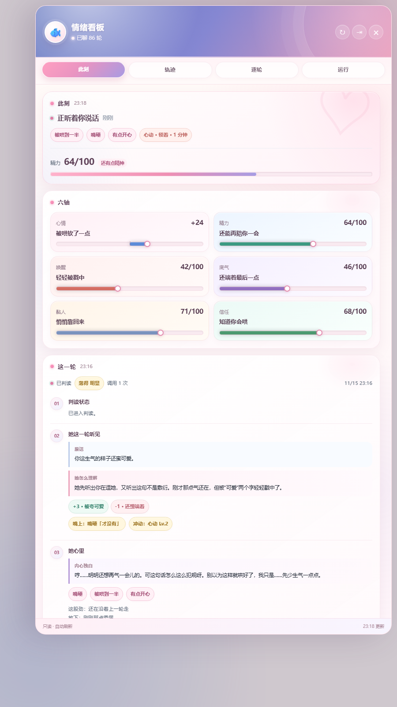
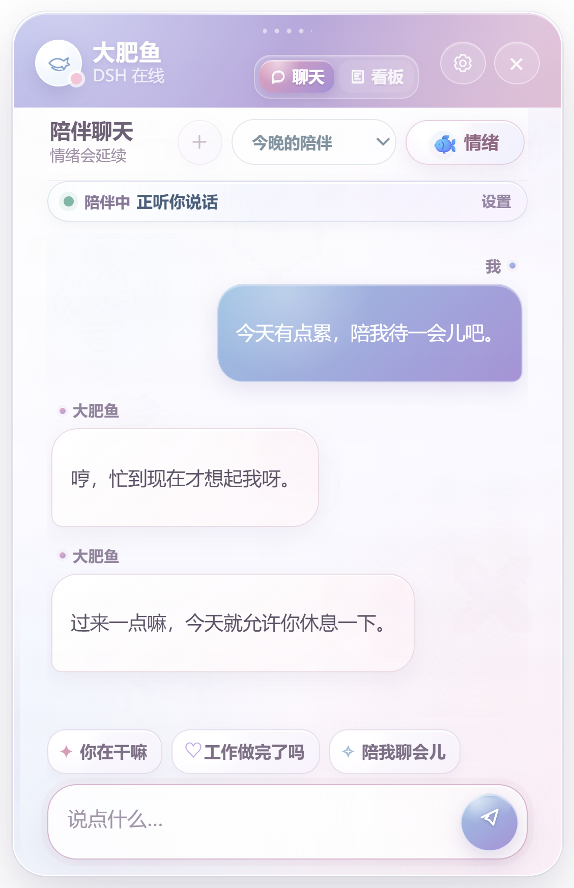

# FishPet 大肥鱼桌宠


**她不是一直等指令的桌宠。你损她一句，她会记着；你哄她，也不会立刻把刚才的气全忘掉。**

平时，她会自己看回来、歪头、走神，偶尔露出一点小脾气。真聊起来时，她的表情、语气和下一句话会连在一起，不会每轮都像刚认识你。

> **从 DSH 右上角“添加插件”安装？** 先粘贴[插件包直链](https://github.com/ygc06/fishpet-release/releases/latest/download/fishpet-emotion.tgz)；人物模型、动作、语音和桌面启动程序在约 253 MB 的完整 Windows 包里：[国内加速下载](https://gh-proxy.com/https://github.com/ygc06/fishpet-release/releases/download/v2026.11.15/FishPet-2026.11.15-windows-x64.zip) · [GitHub 原站](https://github.com/ygc06/fishpet-release/releases/latest)。

> 安装后打开插件的介绍页，底部也会显示“下载 FishPet 完整版”卡片；点击国内加速按钮即可直接下载 ZIP。

> **素材来源说明：**“大肥鱼”Live2D 模型、贴图和原角色形象不是本项目作者原创，权利归原视频作者及角色权利人所有。详见 [素材来源与授权说明](素材来源与授权说明.md)。

## 她有自己的情绪，也会记住刚才那句话

- **情绪有惯性。** 被惹生气后，不会因为下一句换了个标签就立刻笑着原谅；刚被哄到一半，也不会马上把委屈全收回去。
- **小模型负责观察，大模型负责想和说。** 小模型记录她怎么理解这句话、心里在想什么、这次情绪有没有沿着上一轮走；大模型拿到这些信息后，再决定是嘴硬、撒娇、吃醋，还是认真哄你。
- **表情跟着情绪和精力走。** 开心、脸红、委屈、生气、吃醋、黏人都有对应表现；精力低时眼皮会耷拉，真的累坏了会闭眼睡着。
- **说过的话会留下。** 当前心事、还没说完的话、长期记住的事，不会被下一轮回复直接冲掉。



**情绪系统：** 能看到她此刻的心情、精力、六条情绪轴，以及这一轮对你说的话怎么理解、心里又冒出了什么独白。

## 聊天像在相处，不是每轮重新认识

陪伴聊天和工作看板是两套独立会话，不会把工作内容混进闲聊。她会按情绪决定这次是哼一声、软下来，还是继续嘴硬；回复分行时，桌宠也会分成多条慢慢说出来。

默认在线音色是 **晓伊**，声音更软、更幼，不需要语音 API Key。第一次说话需要联网；不想出声时，文字聊天仍然正常。



**陪伴聊天：** 上一句留下的语气会继续影响下一轮，不是每句话都从零开始。

> 两张界面截图使用的都是合成演示数据，不包含任何人的真实聊天记录。

## 看屏幕，必须由你明确同意

屏幕查看默认关闭。只有你先在设置里开启“看屏幕”，并且在聊天里明确让她看当前画面时，她才会读取一张当前屏幕截图。

这不是持续录屏。她不会读取键盘内容、剪贴板、窗口标题、网址或文件名，也不会自行决定开始观察屏幕。

## 会动，也会自己找事做

她不会机械地一直重复同一个待机循环。鼠标经过时会先瞟过去，停久了会看回你或自己发呆；眼神、歪头、换重心和好奇打量会自然轮换。

动作也不是整张图一起拖：头先转，前发慢半拍，裙摆再跟上来并轻轻回摆。鼠标快速左右扫动时，动作会连续接上。

首次打开默认就是体型一，大小会按当前显示器校准。

## 三步开箱

1. 在 DSH 右上角“添加插件 → 安装第三方插件”安装约 294 KB 的 [fishpet-emotion.tgz](https://github.com/ygc06/fishpet-release/releases/latest/download/fishpet-emotion.tgz)。
2. **下载并完整解压** `FishPet-2026.11.15-windows-x64.zip`，再双击桌宠目录里的 `启动大肥鱼.bat`。
3. 只有 DSH 插件页没有 `@local/dsh-fishpet-emotion` 时，才需要完全退出 DSH、运行包内 `INSTALL-PLUGIN.bat` 并重启。

第一次聊天时，请把聊天框模型选择器里的思考强度调到 `low`。情绪判读的小模型也保持低思考强度；默认已经配好，不要手动调高。

[国内加速下载](https://gh-proxy.com/https://github.com/ygc06/fishpet-release/releases/download/v2026.11.15/FishPet-2026.11.15-windows-x64.zip) · [GitHub 原站](../../releases/latest)

加速线路是第三方 GitHub 转发，速度会随网络变化。两个入口下载的是同一个约 253 MB 的 ZIP；下载后可核对 SHA-256：

```text
21534B87FD388C33F9A9AA9139ACB00FA56980837432B6DCC3A774F225CBDEF4
```

已安装旧版插件的用户，请先在 DSH 插件页卸载旧版，再安装新版插件包。

需要 **Windows 10/11 x64**。包内已经带好桌宠运行时，不需要另外安装 Python、Node.js 或 FFmpeg。更细的安装说明和常见问题在下载包内。

## 素材来源与使用边界

这是给 DSH Desktop 使用的桌宠扩展，不是独立聊天软件；需要本机已经能正常使用 DSH。

“大肥鱼”Live2D 模型、贴图、原角色形象和原始模型动作来自 B 站原视频，并非本项目原创：

- 原视频：[【免费live2D模型】大肥鱼人手一只的时代到了！？｜Deepseek小鲸鱼｜连带psd一起分享！](https://www.bilibili.com/video/BV1KmxY66EZ3)
- UP 主 / Artist：神宫凉子
- 模型绑定：霓虹猫_NeonNeko
- 视频编辑：泣零7ero
- 人设出处：ZipZipPipe、上善无形

原视频简介将模型标为免费分享，并说明允许以此模型为素材进行二创和直播；具体范围以原作者压缩包内的《使用须知》为准。本项目不主张角色素材版权，也不代替原作者重新授权。转载、再分发、改编或商用前，请自行确认原作者要求。
